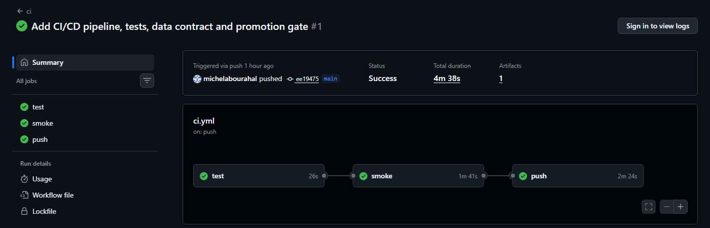
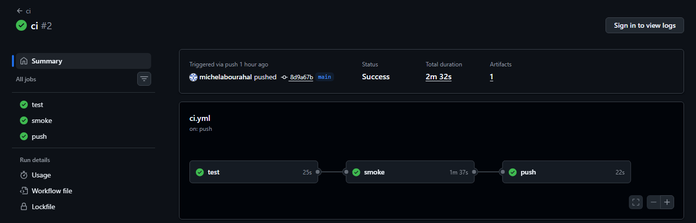
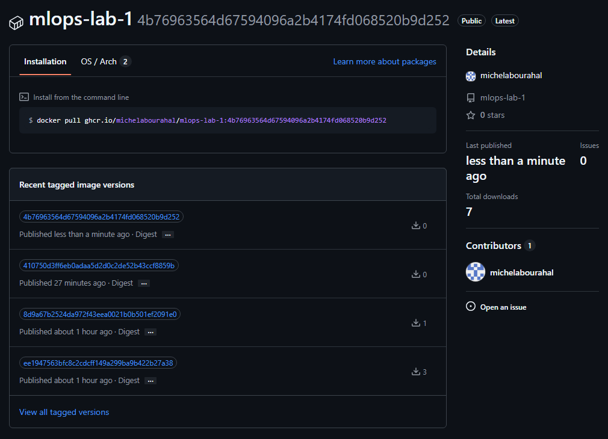
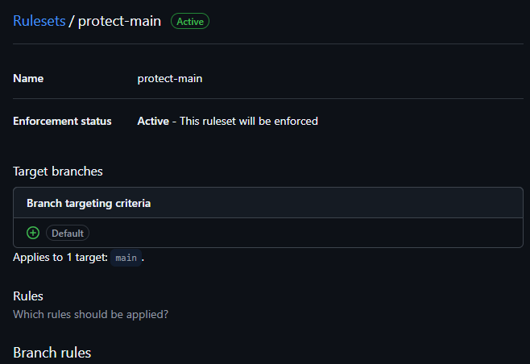
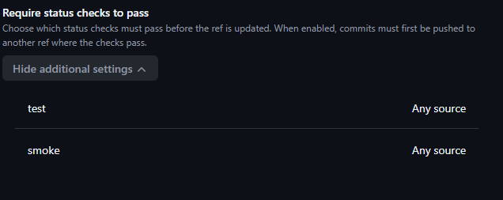
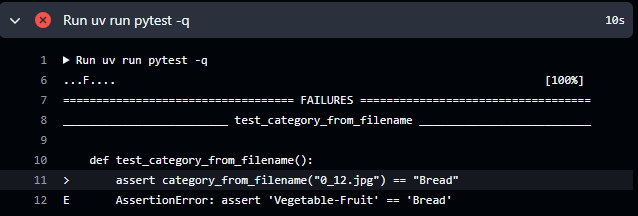
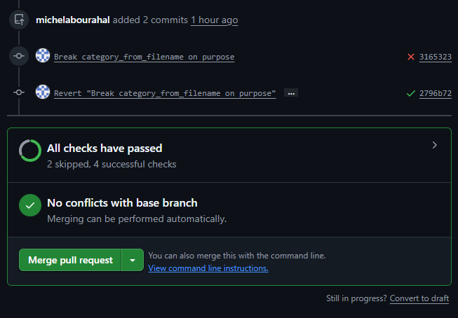
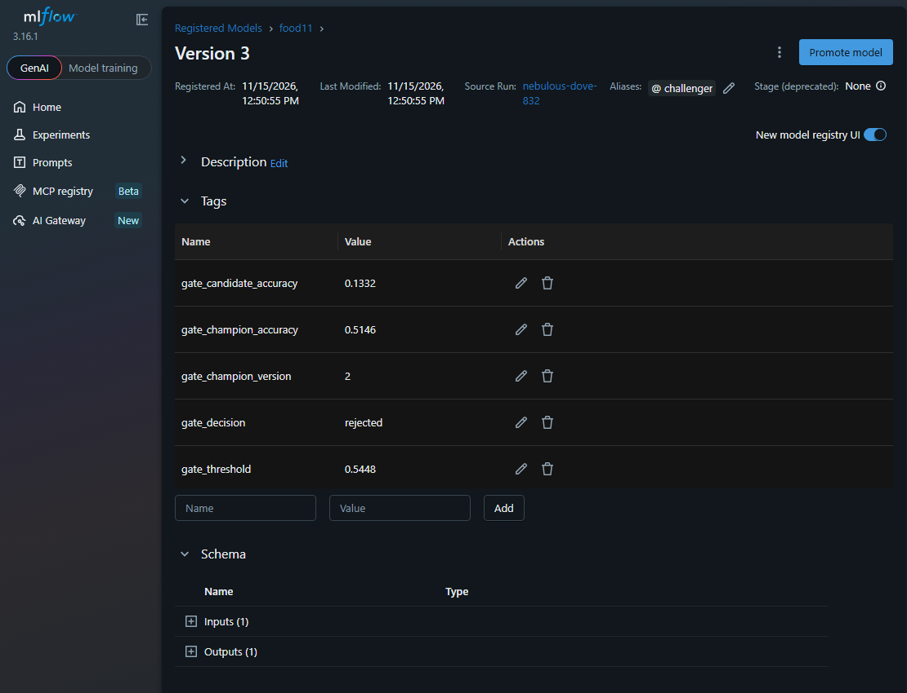

# Lab 5 — CI/CD with GitHub Actions

Repo: https://github.com/michelabourahal/mlops-lab-1

This lab continues the project from [Lab 1](lab1.md) (git+dvc data), [Lab 2](lab2.md)
(training + MLflow tracking), [Lab 3](lab3.md) (Dockerfile serving the model) and
[Lab 4](lab4.md) (Compose stack). Until now linting, testing, building the image and choosing
the model to serve were all manual steps on the laptop. A GitHub Actions workflow now does the
code side on every push:

| Job | When | What it does |
|---|---|---|
| `test` | every push and pull request | `uv sync --frozen`, `ruff check src tests`, `pytest -q` |
| `smoke` | after `test` succeeds | builds the Lab 3 image, starts it with `SKIP_MODEL=1`, probes `/health` |
| `push` | after `smoke` succeeds, on `main` only | pushes the image to `ghcr.io/michelabourahal/mlops-lab-1:<commit SHA>` |

Two scripts cover what the runner cannot see: `validate_data.py` checks the dataset against a
data contract, and `promote.py` applies a quality gate before moving the `champion` alias.

## Deviations from the lab text

- **`lifespan` instead of `@app.on_event("startup")`.** Since Lab 3, `serve.py` loads the model
  in a FastAPI `lifespan` handler (`on_event` is deprecated). The `SKIP_MODEL` check was added
  there. The tests use `with TestClient(serve.app)`, which runs the lifespan, so the behaviour
  is exactly the one the lab describes.
- **`pythonpath = ["."]` for pytest.** The tests import the code as `src.food11...`, the same
  path uvicorn uses in the Dockerfile, so the repo root has to be on `sys.path`
  (`[tool.pytest.ini_options]` in `pyproject.toml`).
- **ruff's current default rules are stricter than the lab assumes.** The first
  `ruff check src tests` (ruff `0.17.5`) reported 8 findings, all fixed:
  - `I001` unsorted imports in `serve.py`, `train.py` and `promote.py`: the repo's `mlflow/`
    folder (the Lab 4 Dockerfile) made ruff treat the `mlflow` package as first-party. Fixed
    with `[tool.ruff.lint.isort] known-third-party = ["mlflow"]`.
  - `B008` in `serve.py`: `file: UploadFile = File(...)` became
    `file: Annotated[UploadFile, File()]`.
  - `RUF059` in `train.py`: the unused `test_loss` became `_`.
  - `PLR0402` in `tests/test_api.py`: the lab's `import src.food11.serve as serve` is written
    `from src.food11 import serve`.
  - `BLE001` and `SIM117` in the new code (a blind `except Exception`, two nested `with`).
- **`data.py` keeps its structure.** The `CLASS_NAMES` dict became the `CLASSES` list, and the
  existing copy loop now calls `category_from_filename` and `resize_image`, so the unit tests
  exercise the code that really builds the dataset. The output is unchanged: 120 raw images
  pushed through `resize_image` again are byte-identical to the files already in
  `data/food11_processed`, so there is no new data version to `dvc add`.
- **Three extra tests.** `test_predict_without_model_returns_503` checks the 503 the lab allows
  when `model is None`, and `tests/test_promote.py` checks the arithmetic of the gate. pytest
  therefore reports 8 tests instead of 5.
- **Image name.** The GitHub username is all lowercase, so `ghcr.io/${{ github.repository }}`
  is used unchanged.
- `lab5.md` sits at the repo root next to the other write-ups (and is added to
  `.dockerignore` like them).

## Make the code testable

### Pure functions in `data.py`

```python
CLASSES = ["Bread", "Dairy product", "Dessert", "Egg", "Fried food", "Meat",
           "Noodles-Pasta", "Rice", "Seafood", "Soup", "Vegetable-Fruit"]


def category_from_filename(filename: str) -> str:
    """'3_120.jpg' -> 'Egg'"""
    return CLASSES[int(Path(filename).name.split("_", 1)[0])]


def resize_image(img: Image.Image, size: int = TARGET_SIZE) -> Image.Image:
    """Returns an RGB image of size x size."""
    return img.convert("RGB").resize((size, size))
```

Importing the module does nothing else: the copy loop only runs from `main()`, under
`if __name__ == "__main__":`.

### A model that can be replaced in tests

```python
model: mlflow.pyfunc.PyFuncModel | None = None


@asynccontextmanager
async def lifespan(app: FastAPI):
    global model
    if not os.environ.get("SKIP_MODEL"):
        mlflow.set_tracking_uri(TRACKING_URI)
        model = mlflow.pyfunc.load_model(MODEL_URI)
    yield
```

`/health` answers 200 either way; `/predict` raises a 503 while `model is None`:

```
SKIP_MODEL=1, no model   POST /predict -> 503      GET /health -> {"status": "ok"}
```

### Q1 — Why is it a bad idea for a unit test to load the real model from your MLflow server? List at least two ways the test could fail even though your code is correct.

A unit test should depend on nothing but the code it tests, so that a red test means "this
code is wrong". Loading `models:/food11@champion` makes the result depend on a server, a
network, the content of the registry at that moment and about 45 MB of ResNet18 weights.
With correct code, the test can still fail because:

- **Nothing is listening.** On a GitHub runner, `http://127.0.0.1:5000` is the runner itself.
  `load_model` raises a connection error during startup, and every API test fails before
  reaching an assertion. The same happens on the laptop whenever the Compose stack is down.
- **The registry changed.** After the `docker compose down -v` of Lab 4 (Q10) the `food11`
  model did not exist at all (`RESOURCE_DOES_NOT_EXIST`). Even when it exists, `champion` is a
  pointer that moves: in Lab 4 (Q8), `Bread/0_0.jpg` was "Fried food" for version 1 and "Bread"
  for version 2. An assertion like `category == "Bread"` would flip when the alias moves,
  without a single line of code changing.
- **The model is simply wrong on that image.** Even the best versions (`test_accuracy`
  around 0.76) are wrong on one image out of four, and in that same Lab 4 example it was the
  better of the two models that called the bread "Fried food". A correct pipeline in front
  of it still fails the assertion.
- **Time and environment.** Downloading and deserializing the weights turns a test of a few
  milliseconds into one that takes many seconds and can time out, and it needs matching
  mlflow versions on both sides.

## Write the tests

`tests/fixtures/bread.jpg` is `evaluation/Bread/0_0.jpg` from the mini dataset (4.5 kB,
committed to git). `tests/test_data.py` is the lab's file; `tests/test_api.py` adds the 503
case.

### Q2 — The fake model always answers "Bread" with 0.90 confidence. What exactly does `test_predict_returns_valid_json` prove, and what does it *not* prove?

```
$ uv run ruff check src tests
All checks passed!
$ uv run pytest -q
........                                                                 [100%]
8 passed, 2 warnings in 21.74s
```

It proves that the plumbing around the model works:

- the app starts with `SKIP_MODEL=1` without contacting MLflow, and the module-level `model`
  can be replaced
- `/predict` accepts a multipart upload, decodes a real JPEG and runs the preprocessing
  without an error
- the decoding of the output is right: the largest value is at index 0, and index 0 is mapped
  to `"Bread"` through the class list
- the response is JSON with a `category` and a `confidence` that is a number between 0 and 1

It does not prove:

- anything about the real model: the fake ignores its input, so the endpoint would answer
  `"Bread"` for a picture of soup
- that the preprocessing matches training (size, normalization, channel order), or even that
  the tensor handed to the model has the right shape: the fake accepts anything
- that the real pyfunc model returns what the fake returns. `serve.py` treats the output as
  logits and applies a softmax. If the real model returned probabilities or a DataFrame, the
  test would still pass
- that the model can be loaded from MLflow at all

The softmax is also why the response is not the 0.90 of the fake:

```
POST /predict (fake model) -> 200 {"category": "Bread", "confidence": 0.19582663949444892}
```

`exp(0.90) / (exp(0.90) + 10 * exp(0.01)) = 0.196`. The test passes because it only checks
that the confidence is in `[0, 1]`.

## Validate the data against a contract

`src/food11/validate_data.py` runs the five checks on a processed dataset folder, prints one
PASS/FAIL line per check (with the first five offending files) and exits with status 1 if any
check failed. Each failing case was tried on a small synthetic dataset (missing or extra class
folder, grayscale / wrong-size / truncated image, too few images, cross-split copy, class
share drift): the expected check fails each time, and a clean synthetic dataset exits with 0.

On the real data:

```
$ uv run python src/food11/validate_data.py data/food11_processed_mini
Data contract for data/food11_processed_mini (3292 images)
PASS  1. each split has exactly the 11 class folders
PASS  2. every image opens, is RGB and 128x128
PASS  3. at least 50 images per class
FAIL  4. no image appears in two splits
        - same content in several splits: training/Bread/0_106.jpg, evaluation/Bread/0_131.jpg
        - same content in several splits: training/Bread/0_186.jpg, evaluation/Bread/0_139.jpg
        - same content in several splits: training/Dairy product/1_185.jpg, validation/Dairy product/1_123.jpg
        - same content in several splits: training/Dessert/2_1046.jpg, validation/Dessert/2_154.jpg
        - same content in several splits: training/Fried food/4_167.jpg, evaluation/Fried food/4_123.jpg
        ... and 38 more
PASS  5. train/validation class shares within 0.05
$ echo $?
1
```

**The contract already fails before anything is broken on purpose.** Food-11 itself contains
byte-identical pictures in different splits:

| Dataset | Duplicate groups | evaluation + training | training + validation | evaluation + validation | Evaluation images that are also in training |
|---|---|---|---|---|---|
| `food11_processed_mini` | 43 | 3 | 2 | 38 | 3 of 1096 (0.27%) |
| `food11_processed` | 611 | 249 | 51 | 311 | 249 of 3347 (7.44%) |

No group mixes two class labels. The dataset was left as it is in this lab, so that the
accuracies of Labs 2–4 stay comparable; removing the copies would mean a new data version in
DVC and retraining. Until then the test accuracies are slightly optimistic, mostly on the full
dataset, and the contract exits with 1 on the real data.

### Q3 — Which check caught it? Why is a train/test duplicate more dangerous than a corrupted image, even though the corrupted image makes the training script crash and the duplicate does not?

**Check 4** (no image appears in two splits). The injected copy is the first line of the
report, and the number of groups goes from 43 to 44:

```
$ cp data/food11_processed_mini/training/Bread/0_0.jpg data/food11_processed_mini/evaluation/Bread/0_0_copy.jpg
$ uv run python src/food11/validate_data.py data/food11_processed_mini
Data contract for data/food11_processed_mini (3293 images)
PASS  1. each split has exactly the 11 class folders
PASS  2. every image opens, is RGB and 128x128
PASS  3. at least 50 images per class
FAIL  4. no image appears in two splits
        - same content in several splits: training/Bread/0_0.jpg, evaluation/Bread/0_0_copy.jpg
        - same content in several splits: training/Bread/0_106.jpg, evaluation/Bread/0_131.jpg
        - same content in several splits: training/Bread/0_186.jpg, evaluation/Bread/0_139.jpg
        - same content in several splits: training/Dairy product/1_185.jpg, validation/Dairy product/1_123.jpg
        - same content in several splits: training/Dessert/2_1046.jpg, validation/Dessert/2_154.jpg
        ... and 39 more
PASS  5. train/validation class shares within 0.05
$ echo $?
1
$ rm data/food11_processed_mini/evaluation/Bread/0_0_copy.jpg
```

Checks 1, 2, 3 and 5 did not notice anything: the copy is a valid 128×128 RGB image in the
right folder, and check 5 only compares the class shares of training and validation.

A corrupted image fails **loudly**: training crashes on it, someone looks, the file is fixed
or removed, and no wrong number was ever produced. A duplicate fails **silently**: everything
runs, but the model is tested on a picture it has already seen with its label, so
`test_accuracy` no longer measures generalization. That number is what every later decision
relies on: which run is the best (Lab 2), which version becomes `champion` (the gate below),
whether the model is good enough to ship. The error only shows up in production, as an
accuracy lower than the one that was promised, and nothing points back to the data. The
full dataset shows the scale it can reach unnoticed: 7.44% of its evaluation images are also
training images.

### Q4 — Your CI runner cannot see your data (it is in DVC, and maybe in a local remote). Where in your workflow should `validate_data.py` run so that it still protects you? Give two places.

Here the DVC remote is a folder on the laptop (`C:\Users\miche\dvc-storage\mlops-lab-1`), so a
GitHub runner cannot `dvc pull` at all. The contract has to run where the data is:

1. **On the laptop, at the moment a dataset version is created or used.** Right after
   `data.py` and before `dvc add` / `dvc push` and before `train.py`. Made automatic, this is
   a `validate` stage placed before the training stage in a DVC pipeline (`dvc repro` stops
   when the script exits 1), or a git pre-commit hook that runs it whenever `data.dvc`
   changes. A bad dataset then never gets versioned, shared or trained on.
2. **In an automated job that can reach the data.** Either a CI job that runs `dvc pull` and
   then `validate_data.py`, triggered only when `data.dvc` changes, once the DVC remote is one
   the runner can reach (DagsHub or S3, credentials stored as repository secrets). Or the same
   job on a self-hosted runner installed on the machine that holds the data. This is the place
   that does not depend on anybody remembering to run the script.

## The CI workflow

`.github/workflows/ci.yml` is the lab's file with the `push` job of the next section:

```yaml
name: ci
on:
  push:
  pull_request:

jobs:
  test:
    runs-on: ubuntu-latest
    steps:
      - uses: actions/checkout@v4
      - uses: astral-sh/setup-uv@v5
        with:
          enable-cache: true
      - run: uv sync --frozen
      - run: uv run ruff check src tests
      - run: uv run pytest -q

  smoke:
    needs: test
    runs-on: ubuntu-latest
    steps:
      - uses: actions/checkout@v4
      - run: docker build -t food11-api:ci .
      - name: start the container without a model and probe it
        run: |
          docker run -d --name api -p 8000:8000 -e SKIP_MODEL=1 food11-api:ci
          for i in $(seq 1 20); do
            curl -sf localhost:8000/health && exit 0
            sleep 2
          done
          docker logs api
          exit 1

  push:
    needs: smoke
    if: github.ref == 'refs/heads/main'
    runs-on: ubuntu-latest
    permissions:
      contents: read
      packages: write
    steps:
      - uses: actions/checkout@v4
      - uses: docker/setup-buildx-action@v3
      - uses: docker/login-action@v3
        with:
          registry: ghcr.io
          username: ${{ github.actor }}
          password: ${{ secrets.GITHUB_TOKEN }}
      - uses: docker/build-push-action@v6
        with:
          context: .
          push: true
          tags: ghcr.io/${{ github.repository }}:${{ github.sha }}
          cache-from: type=gha
          cache-to: type=gha,mode=max
```

`uv sync` does not download the CUDA build of torch: `pyproject.toml` has pointed `torch` and
`torchvision` at the CPU-only index since Lab 2.

### Q5 — The `smoke` job has `needs: test`. What happens to it if a unit test fails? What would happen without `needs`?

With `needs: test`, `smoke` only starts once `test` has succeeded. If a unit test fails,
`test` is marked failed and `smoke` is **skipped**, not run and not failed. `push` needs
`smoke`, so it is skipped too, and the run as a whole is red. This is exactly what run #4
shows (the deliberately broken branch of Q9): `test` failed at the `pytest` step after 24s,
`smoke` and `push` skipped.

Without `needs`, the jobs are independent and start in parallel on separate runners. `smoke`
would build and start the image while the tests are failing: runner minutes spent on the most
expensive job of the workflow for a commit that is already known to be bad, and a confusing
"smoke green, test red" result. The chain would also lose its meaning: `push` only needs
`smoke`, so an image whose unit tests fail could be published.

### Q6 — How long did the whole run take? Run it a second time (push an empty commit with `git commit --allow-empty -m "ci"`) and compare. Which step got faster, and why?

The first run (commit `ee19475`) took **4m 38s**, the second one (the empty commit `8d9a67b`)
**2m 32s**. Both are green. Durations of the jobs and of their main steps, with a third run
that changed one file under `src/` for comparison:

| | Run #1 (`ee19475`) | Run #2 (`8d9a67b`, empty commit) | Run #3 (`410750d`, `promote.py` changed) |
|---|---|---|---|
| **`test` job** | 26s | 25s | 26s |
| `astral-sh/setup-uv` | 1s | 2s | 2s |
| `uv sync --frozen` | 3s | 5s | 7s |
| `ruff check src tests` | <1s | <1s | <1s |
| `pytest -q` | 10s | 13s | 10s |
| **`smoke` job** | 1m 41s | 1m 37s | 1m 45s |
| `docker build -t food11-api:ci .` | 79s | 77s | 83s |
| start the container and probe `/health` | 14s | 15s | 19s |
| **`push` job** | 2m 24s | 22s | 1m 56s |
| `docker/build-push-action` | **128s** | **6s** | 97s |
| **Whole run** | **4m 38s** | **2m 32s** | 4m 14s |





Only one step got faster: **`docker/build-push-action` in the `push` job, from 128s to 6s**.
That job uses BuildKit with `cache-to: type=gha,mode=max`, so the first run exported every
layer of both build stages to the repository's GitHub Actions cache (15 `buildkit` entries,
841 MB in total after run #1). The second run started on an empty runner as always, but
`cache-from: type=gha` found all the layers: nothing in the build context had changed, so
nothing was rebuilt, and the registry already had those layers from run #1, so there was
almost nothing left to upload for the new SHA tag.

Run #3 shows the limit of that cache: with one source file changed, the same step took 97s
again. As in Lab 3 (Q4), the cache only covers the layers above the first instruction whose
input changed; everything after `COPY src/` is rebuilt and pushed.

The other steps did not get faster, each for its own reason:

- **`docker build` in `smoke`** (79s → 77s) is a plain `docker build` on a fresh machine with
  no cache configured. It reinstalls the whole environment on every run and is now the
  slowest step of the pipeline. Building it with the same `type=gha` cache as the `push` job
  would be the next thing to fix.
- **`uv sync --frozen`** (3s → 5s) has `enable-cache: true`, but the cache `setup-uv` saved
  after run #1 is practically empty (the `setup-uv-…` entry is 3.8 kB): before saving, it
  prunes the wheels that can simply be downloaded again, and every dependency here is such a
  wheel. The second run restored that cache but had nothing useful in it, so it downloaded
  the packages again, which only takes a few seconds on a runner.
- **`pytest`** (10s → 13s) has nothing to cache: most of its time is importing torch and
  mlflow.

## Push the image to the registry

The `push` job only runs on `main`, after `test` and `smoke`. Each of the three pushes to
`main` published one image, and the registry lists them under the full commit SHAs:

```
$ curl -s -H "Authorization: Bearer $TOKEN" https://ghcr.io/v2/michelabourahal/mlops-lab-1/tags/list
{"name":"michelabourahal/mlops-lab-1","tags":["ee1947563bfc8c2cdcff149a299ba9b422b27a38","8d9a67b2524da972f43eea0021b0b501ef2091e0","410750d3ff6eb0adaa5d2d0c2de52b43ccf8859b"]}

manifest per tag:
ee19475  HTTP 200  sha256:1741cb527122cb6c6d69bd366cc0a4e78ef6a79784b7f51c35655bdbdfdb2014
8d9a67b  HTTP 200  sha256:9bf478e0e62c103abd286fc0398631459f19a3a877110497c14fa5ec86c1a32f
410750d  HTTP 200  sha256:30ea7acfe5b9c058c1a117b4ba7e2a1a8abcc706159c9b465c559387694e938f
3165323  HTTP 404  (the broken commit of the `break-test` branch, see Q9: never published)
```



The screenshot was taken after the merge of Q9, hence a fourth tag: `4b76963…` is the merge
commit of pull request #1.

`$TOKEN` is the anonymous pull token from `https://ghcr.io/token`, so the package is public
like the repository and can be pulled without `docker login`. On the laptop:

```
$ docker pull ghcr.io/michelabourahal/mlops-lab-1:410750d3ff6eb0adaa5d2d0c2de52b43ccf8859b
410750d3ff6eb0adaa5d2d0c2de52b43ccf8859b: Pulling from michelabourahal/mlops-lab-1
b2e0bfe2102f: Already exists
440f8d461d11: Download complete
440f8d461d11: Pull complete
b2e0bfe2102f: Pull complete
Digest: sha256:30ea7acfe5b9c058c1a117b4ba7e2a1a8abcc706159c9b465c559387694e938f
Status: Downloaded newer image for ghcr.io/michelabourahal/mlops-lab-1:410750d3ff6eb0adaa5d2d0c2de52b43ccf8859b

$ docker images --format '{{.Repository}}:{{.Tag}}  {{.Size}}  id={{.ID}}' | grep ghcr
ghcr.io/michelabourahal/mlops-lab-1:410750d3ff6eb0adaa5d2d0c2de52b43ccf8859b  2.01GB  id=30ea7acfe5b9
```

The digest is the one the registry announced for that tag. (`Already exists` on the first
layer: an earlier attempt at the same pull had been interrupted after downloading it.)

The pulled image, not a local build, then served the model. It was started next to the
Compose `mlflow` service, on the same network:

```
$ docker run -d --name food11-ci-image --network mlops-lab-1_default \
    -e MLFLOW_TRACKING_URI=http://mlflow:5000 -p 8000:8000 \
    ghcr.io/michelabourahal/mlops-lab-1:410750d3ff6eb0adaa5d2d0c2de52b43ccf8859b
$ curl localhost:8000/health
{"status":"ok"}
$ curl -F "file=@tests/fixtures/bread.jpg" localhost:8000/predict
{"category":"Bread","confidence":0.2661406397819519}
$ curl -F "file=@data/food11_processed_mini/validation/Seafood/8_0.jpg" localhost:8000/predict
{"category":"Seafood","confidence":0.8864715099334717}
$ curl -F "file=@data/food11_processed_mini/validation/Soup/9_0.jpg" localhost:8000/predict
{"category":"Soup","confidence":0.9985033869743347}
```

`/health` answered about 30 seconds after `docker run`, the time to download and load
`models:/food11@champion`, which at that moment was version 4 (promoted by the gate, Q10).

### Q7 — This answers Question 9 of Lab 3. Why tag with the commit SHA rather than `latest`? Describe a concrete situation where `latest` leads two machines to run different code.

In Lab 3 (Q9) the image only existed in the laptop's Docker cache as `food11-api:latest`: no
other machine could get it, and the name said nothing about what was inside. It is now in a
registry under a name that identifies its content.

A SHA tag is **traceable and stable**: `410750d…` is one commit, so from a running container
the exact source can be found in git, rebuilt, and compared with what was tested. Rolling
back is pulling the previous SHA. `latest` is a pointer that every push to `main` would move:
the tag alone does not say which code it holds, and the image it used to point to has no
name left to roll back to.

A concrete case: on Monday, server A runs `docker pull …:latest` and starts the API from
commit X. On Tuesday a pull request that changes the preprocessing in `serve.py` is merged,
and CI pushes commit Y as `latest`. On Wednesday server B is added behind the same load
balancer; it pulls `latest` and gets Y. Both servers "run latest", but Docker does not pull
again a tag it already has locally, so A stays on X. The same photo now gets a different
prediction depending on which server answers, and `docker ps` shows the same image name on
both. With SHA tags the deployment names the commit, and a machine can only run something
else if somebody changes that line. (A SHA tag could still be overwritten by somebody with
write access to the package; the digest above is the only reference that cannot.)

### Q8 — Why does the `push` job declare `permissions:` explicitly? What could a compromised step do with a token that had write access to everything in the repo?

Without a `permissions:` block, `GITHUB_TOKEN` gets the repository's default, which depending
on the settings is read/write on almost every scope. Declaring it makes the job independent
of that setting and applies least privilege: as soon as one permission is listed, every scope
that is not listed is set to none. This job needs to read the code (`contents: read`) and to
publish a package (`packages: write`), nothing else.

Every `uses:` line runs somebody else's code with that token, and the actions are referenced
by tags (`@v4`, `@v6`) that their owner can move. That is what happened to
`tj-actions/changed-files` in March 2025: its tags were repointed to a malicious commit. With a
token that can write everywhere, a compromised step could:

- push commits to branches (a backdoor in `serve.py`), move tags, create or edit releases
- approve or merge pull requests, close or edit issues
- overwrite or delete packages, for example replace the image behind an existing tag
- start other workflows or deployments, all within the lifetime of the job's token

With `contents: read` + `packages: write`, the worst case is limited to the package registry.
Two further hardening steps would be a top-level `permissions: contents: read` for `test` and
`smoke`, and pinning the actions to a commit SHA instead of a tag.

## Protect main with the pipeline

A ruleset named `protect-main` now guards the default branch. It is **Active**, targets the
default branch, and its bypass list is empty:

- **Require a pull request before merging** (0 approvals required, since there is nobody
  else to approve)
- **Require status checks to pass**: `test` and `smoke`





On the branch `break-test`, `category_from_filename` was broken on purpose with an
off-by-one (commit `3165323`):

```python
return CLASSES[int(Path(filename).name.split("_", 1)[0]) - 1]
```

ruff has nothing to say about it, but a unit test does:

```
$ uv run pytest -q
...F....                                                                 [100%]
    def test_category_from_filename():
>       assert category_from_filename("0_12.jpg") == "Bread"
E       AssertionError: assert 'Vegetable-Fruit' == 'Bread'

FAILED tests/test_data.py::test_category_from_filename
1 failed, 7 passed, 2 warnings in 20.54s
```

Pushing the branch started run #4 of the workflow, which ended red after 27s. Nothing was
built and nothing was published for that commit: the registry answers 404 for the tag
`3165323…` (listing above).

### Q9 — What does the pull request page show? Could you still merge? What does that change for a team compared to "everybody runs the tests on their laptop before pushing"?

Pull request #1 (`break-test` → `main`) with the broken commit. Opening it started the
workflow a second time, for the `pull_request` event (run #7), so every check appears twice:

| Check | `push` event (run #4) | `pull_request` event (run #7) |
|---|---|---|
| `test` | **failed** at `uv run pytest -q` | **failed** at `uv run pytest -q` |
| `smoke` | skipped | skipped |
| `push` | skipped | skipped |

The log of the `test` job in run #7 shows the same failure as on the laptop. The step
`uv run pytest -q` stops after 10s on `test_category_from_filename`:



```
pull request #1, head 3165323:   mergeable = true   mergeable_state = blocked
```

There is no conflict with `main` (`mergeable = true`), but GitHub reports the pull request as
**blocked**: the required check `test` is red. **It could not be merged**, and not by its
author either: the bypass list of the ruleset is empty, so the rule also applies to the
owner of the repository.

The fix was pushed to the same branch (`2796b72`, a revert of the broken commit). Both
events ran again (runs #8 and #9): `test` green in about 20s, `smoke` green in about 90s,
and the state of the pull request went from `blocked` to `clean`:

```
pull request #1, head 2796b72:   mergeable = true   mergeable_state = clean
```



The page lists the two commits, the broken one with a red cross and the revert with a green
tick, then "All checks have passed" (4 successful, 2 skipped: the two `push` jobs, which
only run on `main`) and "No conflicts with base branch". Only at that point was the **Merge
pull request** button available. The merge created commit `4b76963` on `main`
(`Merge pull request #1 from michelabourahal/break-test`).
That push to `main` ran the whole pipeline once more (run #10, green in 2m 12s) and
published the image tagged `4b76963…`.

What it changes for a team: "everybody runs the tests before pushing" is a convention. It
holds as long as nobody forgets, nobody is in a hurry, and every laptop has the same Python,
the same packages and the same files lying around. A test can pass on one machine only
because of a stale `.venv` or a file that was never committed, and nobody else can see
whether the tests were run at all.

With required checks, the rule is enforced by the platform instead of by discipline:

- the tests run for every pull request, in a clean environment built from `uv.lock`, the same
  for everyone, and against exactly the commit that would be merged
- the result is attached to the pull request, so a reviewer sees it without running anything
- a red check blocks the merge, so `main` only ever receives code that passed, and since the
  `push` job runs on `main` only, a broken commit cannot reach the image registry either
- the off-by-one above would have relabelled every image of the dataset; here it costs one
  red pull request instead of a wrong dataset version

## A quality gate for the model

`src/food11/promote.py` applies the gate from the lecture:

```python
def standard_error(p: float, n: int) -> float:
    return math.sqrt(p * (1 - p) / n)


def should_promote(acc_candidate: float, acc_champion: float, n: int) -> bool:
    return acc_candidate >= acc_champion + 2 * standard_error(acc_champion, n)
```

- the candidate comes from `client.get_model_version("food11", <version>)`, the champion from
  `client.get_model_version_by_alias("food11", "champion")`; both accuracies are the
  `test_accuracy` metric of the run behind each version
- `n` is the `test_samples` param that `train.py` logs with every run (the size of the
  `evaluation` split the accuracy was measured on); `--n` overrides it
- promoted: `champion` moves to the candidate. Rejected: the candidate gets `challenger` and
  `champion` stays where it is
- in both cases the candidate version is tagged with `gate_decision`,
  `gate_candidate_accuracy`, `gate_champion_accuracy`, `gate_champion_version` and
  `gate_threshold`
- it reads `MLFLOW_TRACKING_URI` from the environment, like `serve.py`
- it fails closed: "no champion yet" is only accepted when MLflow reports that the alias is
  not set (the first version then becomes the champion). Any other error while reading the
  champion stops the script, so a registry outage cannot turn into a promotion

### Q10 — For each candidate, what did the gate decide, and with which numbers? With your test-set size, how many accuracy points does `2 * se` represent?

Registry before the gate. `champion` was still on version 2, the deliberately worse model
that Lab 4 (Q8) moved the alias to in order to make the switch visible:

| Version | Run | `lr` | `test_accuracy` | Alias |
|---|---|---|---|---|
| 1 | `treasured-boar-863` | 0.0001 | 0.7564 | – |
| 2 | `melodic-rat-639` | 0.001 | 0.5146 | `champion` |

Two new runs on the mini dataset (5 epochs, batch size 32), each registered with
`mlflow.register_model("runs:/<run_id>/model", "food11")`:

| Version | Run | `lr` | `test_accuracy` |
|---|---|---|---|
| 3 | `nebulous-dove-832` | 0.000001 (very small) | 0.1332 |
| 4 | `enthused-kit-77` | 0.0001 (best settings) | 0.7619 |

With `lr=1e-6` the network barely moves in 5 epochs: 0.1332 is hardly above the 1/11 = 0.091
of a random guess.

```
$ uv run python src/food11/promote.py --version 3
candidate  v3  test_accuracy=0.1332
champion   v2  test_accuracy=0.5146
n=1096  se=0.0151  threshold = champion + 2*se = 0.5448
decision   rejected: v3 is now 'challenger'

$ uv run python src/food11/promote.py --version 4
candidate  v4  test_accuracy=0.7619
champion   v2  test_accuracy=0.5146
n=1096  se=0.0151  threshold = champion + 2*se = 0.5448
decision   promoted: v4 is now 'champion'
```

| Candidate | `test_accuracy` | Champion at that moment | Threshold | Decision |
|---|---|---|---|---|
| v3 (`lr=1e-6`) | 0.1332 | v2, 0.5146 | 0.5448 | **rejected**, alias `challenger` |
| v4 (`lr=1e-4`) | 0.7619 | v2, 0.5146 | 0.5448 | **promoted**, alias `champion` |

Registry after the two runs of the script:

```
aliases: {'challenger': '3', 'champion': '4'}
v1 treasured-boar-863   test_accuracy=0.7564 tags={}
v2 melodic-rat-639      test_accuracy=0.5146 tags={}
v3 nebulous-dove-832    test_accuracy=0.1332 tags={'gate_candidate_accuracy': '0.1332', 'gate_champion_accuracy': '0.5146', 'gate_champion_version': '2', 'gate_decision': 'rejected', 'gate_threshold': '0.5448'}
v4 enthused-kit-77      test_accuracy=0.7619 tags={'gate_candidate_accuracy': '0.7619', 'gate_champion_accuracy': '0.5146', 'gate_champion_version': '2', 'gate_decision': 'promoted', 'gate_threshold': '0.5448'}
```




**How many points is `2 * se`?** The test split is `data/food11_processed_mini/evaluation`,
n = 1096 images, and the margin depends on the champion's accuracy:

```
champion at 0.5146 (v2):  se = sqrt(0.5146 * 0.4854 / 1096) = 0.0151   2*se = 0.0302 -> 3.0 points
champion at 0.7619 (v4):  se = sqrt(0.7619 * 0.2381 / 1096) = 0.0129   2*se = 0.0257 -> 2.6 points
```

So with 1096 test images the gate asks for a lead of about 2.6 to 3 accuracy points (3.0 is
the maximum, reached at 50% accuracy). The next candidate has to reach 0.7876 to replace
version 4.

That margin matters here. Version 4 (0.7619, 835 images right) and version 1 (0.7564, 829
images right) come from the same settings and differ by 6 test images, half a point, less
than one standard error. Version 4 was promoted because the champion it was compared with
was the weak version 2. Had `champion` still been on version 1, the threshold would have
been 0.7564 + 0.0259 = 0.7823 and the gate would have kept version 1: it does not replace a
serving model for a difference that 1096 images cannot distinguish from noise.

### Q11 — `promote.py` needs to reach your MLflow server, so it cannot run in GitHub's cloud runners while MLflow lives on your laptop. Name two ways to make it run automatically after training.

1. **Put the tracking server where the runners can reach it.** DagsHub gives every repository
   a hosted MLflow server (`https://dagshub.com/<user>/<repo>.mlflow`). With
   `MLFLOW_TRACKING_URI` pointing there and the DagsHub token stored as GitHub secrets
   (`MLFLOW_TRACKING_USERNAME` / `MLFLOW_TRACKING_PASSWORD`), a workflow on a normal cloud
   runner can run `promote.py`: started with `workflow_dispatch` and the version number as an
   input, or by the training script through the API once the version is registered.
   `promote.py` already reads the URI from the environment; `train.py` would have to do the
   same instead of hardcoding `http://127.0.0.1:5000`.
2. **Run it where MLflow already is.** Either chain it to training on the laptop: a DVC
   pipeline `validate → train → register → promote`, so that `dvc repro` always ends with the
   gate, or `train.py` registering its model and calling the gate as its last step. Or install
   a **self-hosted runner** on the laptop: a job with `runs-on: self-hosted` executes there,
   reaches `127.0.0.1:5000`, and GitHub only does the scheduling.

## Commit

```bash
git add .github/workflows/ci.yml tests/ src/food11/validate_data.py src/food11/promote.py \
        src/food11/data.py src/food11/serve.py src/food11/train.py pyproject.toml uv.lock .dockerignore
git commit -m "Add CI/CD pipeline, tests, data contract and promotion gate"
git push
```

### Q12 — Draw the pipeline you now have, from `git push` to a running container. Mark which steps are automatic, which still need a human, and where the code version and the model version are decided.

`[H]` = a human does it, `[A]` = automatic.

```
 CODE PATH (GitHub)                                 MODEL PATH (laptop + MLflow)
 ------------------                                 ----------------------------

 [H] git push on a branch, open a pull request      [H] data.py / dvc pull
          |                                                  |
 [A] ci / test    uv sync, ruff, pytest             [H] validate_data.py   (data contract)
          |                                                  |
 [A] ci / smoke   docker build, /health             [H] train.py   -> run + test_accuracy
          |                                                  |
 [A] ruleset: test + smoke must be green            [H] register the run as food11 version n
          |                                                  |
 [H] merge the pull request into main               [H] promote.py --version n
          |      ^                                           |
          |      +-- CODE VERSION decided here      [A] gate: acc >= champion + 2*se ?
          |          (the merge commit's SHA)            yes |              | no
 [A] ci on main: test -> smoke -> push              champion -> vn     challenger -> vn
          |                                                  ^
 ghcr.io/michelabourahal/mlops-lab-1:<SHA>                   +-- MODEL VERSION decided here
          |                                                      (whatever champion points to)
          +----------------------+---------------------------+
                                 |
          [H] docker pull <SHA>  /  docker compose up
                                 |
          [A] container start: load models:/food11@champion
                                 |
                    running API (+ frontend)
```

| Step | Who | What it decides |
|---|---|---|
| Lint, unit tests, smoke test on every push and pull request | automatic | whether the code may enter `main` |
| Merging a green pull request | human | **the code version**: the SHA of the commit on `main` |
| Building and pushing the image tagged with that SHA | automatic (`push` job) | nothing new: it packages that code version |
| Validating data, training, registering a version | human, on the laptop | which candidates exist |
| Starting `promote.py` | human | – |
| Moving `champion` or `challenger` | automatic (the gate's rule) | **the model version**: whatever `champion` points to |
| Deploying (`docker pull <SHA>`, `docker compose up`) | human | which code version actually runs |
| Loading the model at container start | automatic | resolves `champion` to a model version at that moment |

The two versions are decided in two different places and released independently. The image
is identified by a git commit SHA and contains no model. The model is identified by a
registry alias and is fetched at startup, so moving `champion` and restarting the container
changes the model without a rebuild (Lab 4, Q9), and a new image can be deployed without
touching the model. What still needs a human: merging, training and registering, starting
the gate, and deploying.

The whole path was walked once by hand: commit `410750d` on `main` → `test`, `smoke`, `push`
green → image `ghcr.io/michelabourahal/mlops-lab-1:410750d…` → `docker pull` and `docker run`
on the laptop → `champion` resolved to version 4 at startup → predictions (section "Push the
image to the registry"). `docker-compose.yml` itself still builds the inference image
locally; pointing it at `ghcr.io/michelabourahal/mlops-lab-1:<SHA>` would make the deployed
stack run exactly the image CI tested.
